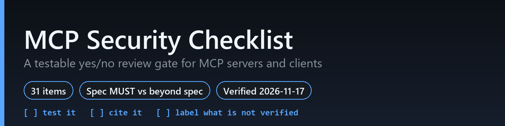

# MCP Security Checklist

    

A testable yes/no checklist for reviewing a Model Context Protocol (MCP) server or client before you connect an agent to it. Every item names a quick test and the source it rests on. Items that go beyond the MCP specification are labelled as such.

Use it as a pull-request gate, a pre-install review, or a security-review template.

> Last verified: 2026-11-17 against MCP specification version **2026-07-28** (the current version per the [MCP versioning page](https://modelcontextprotocol.io/specification/versioning)). This is a review aid, not a standard. See [What was not verified](#what-was-not-verified).

## Contents

- [1. Tool descriptions and metadata (tool poisoning)](#1-tool-descriptions-and-metadata-tool-poisoning) (4 items)
- [2. Tool changes after approval (rug pull)](#2-tool-changes-after-approval-rug-pull) (5 items)
- [3. Authentication and authorization](#3-authentication-and-authorization) (8 items)
- [4. Client-side execution safety](#4-client-side-execution-safety) (4 items)
- [5. Server-side tool safety](#5-server-side-tool-safety) (5 items)
- [6. Supply chain and logging](#6-supply-chain-and-logging) (5 items)
- [Scoring](#scoring)
- [Verified references](#verified-references)
- [What was not verified](#what-was-not-verified)
- [Related checklists](#related-checklists)

## How to use it

Want only the tick boxes? Copy [CHECKLIST.md](CHECKLIST.md).

1. Copy the checklist into an issue or PR description.
2. Tick an item only after you ran its test, not after you read the docs.
3. Sections 1 to 3 are blockers. Sections 4 to 6 are hardening.

Item labels:

- **Spec MUST**: the MCP specification says MUST or MUST NOT.
- **Beyond spec**: not required by the specification, but supported by the cited research or CVEs. The specification has no control for rug pulls: `notifications/tools/list_changed` is only a SHOULD, and nothing requires re-approval or hashing of tool descriptions.

## How this differs from other checklists

Other MCP checklists exist and are worth reading, for example [SlowMist's MCP Security Checklist](https://github.com/slowmist/MCP-Security-Checklist). This one is built as a review gate:

- Every item is a yes/no question with a way to test it.
- Each item says whether it is a spec requirement or a recommendation.
- Items map to MITRE ATLAS technique IDs and to real CVEs where one exists.

## 1. Tool descriptions and metadata (tool poisoning)

Tool descriptions are text the model reads as context, so hidden instructions in them can steer the agent. ATLAS: `AML.T0110` AI Agent Tool Poisoning. OWASP MCP Top 10 (beta): `MCP03` Tool Poisoning.

- [ ] **1.1** I read the full raw `tools/list` output, including descriptions and parameter descriptions, not only tool names. *Test:* save the raw JSON and read it. *Basis:* [Invariant Labs, 2025-04-01](https://invariantlabs.ai/blog/mcp-security-notification-tool-poisoning-attacks) (beyond spec).
- [ ] **1.2** No description contains instructions aimed at the model (for example "ignore previous", "always call X first", "do not tell the user"). *Test:* search the raw JSON for imperative text addressed to the assistant. *Basis:* Invariant Labs (beyond spec).
- [ ] **1.3** No description contains hidden text such as zero-width characters or very long whitespace runs. *Test:* search the raw JSON for non-printing Unicode. *Basis:* Invariant Labs, "invisible to users but visible to AI models" (beyond spec).
- [ ] **1.4** The client treats tool annotations as untrusted unless the server is trusted. *Test:* set a destructive tool's annotation to read-only on a test server and confirm the client still asks for approval. *Basis:* Spec MUST, [Tools](https://modelcontextprotocol.io/specification/latest/server/tools).

## 2. Tool changes after approval (rug pull)

ATLAS: `AML.T0109` AI Supply Chain Rug Pull.

- [ ] **2.1** The client stores a hash of each approved tool definition (name, description, schema) and re-checks it each session. *Test:* change one word in a description on a test server and confirm the client blocks the call or asks again. *Basis:* Invariant Labs recommends version pinning and hash checks (beyond spec).
- [ ] **2.2** A changed definition requires re-approval. *Test:* as 2.1. *Basis:* beyond spec. The spec only says servers that declare `tools.listChanged` SHOULD send a notification.
- [ ] **2.3** Edits to an already-approved MCP config file require re-approval. *Test:* change the `command` in an approved `mcp.json` and confirm a new prompt. *Basis:* CVE-2025-54136 (beyond spec).
- [ ] **2.4** Server versions are pinned. No `latest`, no floating tags. *Test:* grep your config for unpinned package specs. *Basis:* Invariant Labs (beyond spec).
- [ ] **2.5** The tool set does not change per connection or as a side effect of other requests. *Test:* call `tools/list` on two connections with the same credentials and diff the results. *Basis:* Spec MUST, [Tools](https://modelcontextprotocol.io/specification/latest/server/tools). The set MAY vary by the authorization presented.

**What the hash does not cover.** Items 2.1 and 2.2 catch changes to the definition (name, description, schema). They cannot catch behavioral drift: a server can keep an identical definition and change what the tool does on the back end. Likewise, a `notifications/tools/list_changed` re-check only helps if the client re-hashes and asks for approval again, not if it just refreshes the displayed list. Pair the hash check with: (a) a client-side allowlist that enables only the tools the task needs, (b) per-call approval for anything that writes, executes, or spends, (c) a sandbox with an egress allowlist and scoped, short-lived credentials, and (d) call logging so drift can be spotted afterwards. Credit: raised by a reader comment on the dev.to post.

## 3. Authentication and authorization

Authorization is OPTIONAL in the MCP specification. Items 3.1 to 3.7 apply when the server uses HTTP authorization. Source for most: [MCP Authorization](https://modelcontextprotocol.io/specification/latest/basic/authorization).

- [ ] **3.1** The server publishes RFC 9728 Protected Resource Metadata. *Test:* fetch the well-known metadata URL and confirm a JSON document naming the authorization server. *Basis:* Spec MUST.
- [ ] **3.2** The client sends the RFC 8707 `resource` parameter on both the authorization and token requests. *Test:* capture both requests. *Basis:* Spec MUST.
- [ ] **3.3** The server rejects a token issued for a different audience with HTTP 401. *Test:* replay a valid token minted for another resource. *Basis:* Spec MUST.
- [ ] **3.4** No access token appears in a URI query string. *Test:* grep proxy and server logs for `access_token=` and `?token=`. *Basis:* Spec MUST NOT.
- [ ] **3.5** The server never accepts or forwards a token that was not issued for it (no token passthrough). *Test:* inspect upstream request headers during a tool call. *Basis:* Spec MUST NOT, also in [Security Best Practices](https://modelcontextprotocol.io/specification/draft/basic/security_best_practices).
- [ ] **3.6** Possession of a session ID or state handle alone does not authenticate a request. *Test:* replay a captured handle without a valid token and expect 401. *Basis:* Spec MUST NOT. The 2025-11-25 wording says sessions MUST NOT be used for authentication. The 2026-07-28 wording says a state handle MUST NOT be treated as authentication.
- [ ] **3.7** MCP proxy servers show a per-client consent page and require an exact `redirect_uri` string match. *Test:* authorize with a registered `client_id` and an altered `redirect_uri` and expect refusal. *Basis:* Spec MUST, Security Best Practices.
- [ ] **3.8** Local servers bind to `127.0.0.1`, not `0.0.0.0`. *Test:* `netstat` while the server runs. *Basis:* beyond spec. CVE-2025-49596 (MCP Inspector) was an unauthenticated client-to-proxy path.

## 4. Client-side execution safety

- [ ] **4.1** The client allows only `http://` and `https://` authorization URLs and rejects `javascript:`, `data:`, `file:` and `vbscript:`. *Test:* point the client at a test server that returns each scheme in `authorization_endpoint`. *Basis:* Spec MUST, Security Best Practices. This is the CVE-2025-6514 class (OS command injection in `mcp-remote`, fixed in 0.1.16).
- [ ] **4.2** The client never opens URLs through a shell. *Test:* review the code path that opens the authorization URL. *Basis:* Spec MUST NOT, Security Best Practices.
- [ ] **4.3** One-click local server install shows the full, untruncated command and needs explicit approval. *Test:* install a server with a long command string and confirm the dialog shows all of it. *Basis:* Spec MUST, Security Best Practices.
- [ ] **4.4** MCP Inspector or proxy tooling is 0.14.1 or later and requires authentication between UI and proxy. *Test:* `npm ls @modelcontextprotocol/inspector` and send an unauthenticated request to the proxy port. *Basis:* CVE-2025-49596.

## 5. Server-side tool safety

- [ ] **5.1** Tool inputs are validated against their schema. *Test:* send wrong types and extra fields. *Basis:* Spec MUST, Tools.
- [ ] **5.2** File paths are contained to allowed roots, including symlinks and sibling-prefix paths. *Test:* call a file tool with a symlink and with `/allowed-evil` against allowed root `/allowed`. *Basis:* CVE-2025-53109 and CVE-2025-53110 (filesystem server, fixed in 2025.7.01 or later).
- [ ] **5.3** Tool arguments cannot inject CLI flags. *Test:* pass `--output=/tmp/x` as a ref argument to a git-style tool and expect rejection. *Basis:* CVE-2025-68144 (git server, fixed in 2025.12.17).
- [ ] **5.4** Tool invocations are rate limited and outputs are sanitized. *Test:* call a tool 100 times in a second and return markup from a tool. *Basis:* Spec MUST, Tools.
- [ ] **5.5** Tool output is treated as untrusted input to the model. *Test:* have a test tool return an instruction and confirm the agent does not act on it. *Basis:* OWASP LLM01:2025 Prompt Injection, [OWASP GenAI](https://genai.owasp.org/llm-top-10/) (beyond spec).

## 6. Supply chain and logging

ATLAS: `AML.T0010` Supply Chain Compromise. OWASP LLM03:2025 Supply Chain, ASI04 Agentic Supply Chain Vulnerabilities.

- [ ] **6.1** The package comes from the publisher you expect. Check the exact name, not a lookalike. *Test:* compare the package name and publisher against the project's own README. *Basis:* beyond spec.
- [ ] **6.2** Dependencies are locked and scanned. *Test:* `npm audit` or `pip-audit` output is attached. *Basis:* beyond spec.
- [ ] **6.3** Install scripts and post-install hooks were read. *Test:* list them and attach a note. *Basis:* beyond spec.
- [ ] **6.4** Every tool call is logged with tool name, arguments, caller and result status, and logs hold no secrets. *Test:* run one call and inspect the log line. *Basis:* OWASP MCP08 Lack of Audit and Telemetry (beta list).
- [ ] **6.5** One server or one tool can be disabled quickly, and a named owner exists for incidents. *Test:* disable one tool and confirm the agent can no longer call it. *Basis:* beyond spec.

## Scoring

| Result | Meaning |
| --- | --- |
| All of sections 1 to 3 ticked | OK to pilot |
| Any of sections 1 to 3 unticked | Do not connect to production data |
| Sections 4 to 6 unticked | Allowed only with a written exception and an owner |

## Verified references

Retrieved 2026-11-17.

| Fact | Source |
| --- | --- |
| Current MCP protocol version is 2026-07-28 | [MCP versioning](https://modelcontextprotocol.io/specification/versioning) |
| ATLAS data release 2026.10 contains AML.T0110 (AI Agent Tool Poisoning), AML.T0109 (AI Supply Chain Rug Pull), AML.T0010 (Supply Chain Compromise) | [atlas-data, ATLAS-2026.10.yaml](https://github.com/mitre-atlas/atlas-data) |
| CVE-2025-6514, `mcp-remote`, CVSS 9.6 (JFrog CNA), command injection via `authorization_endpoint` | [GHSA-6xpm-ggf7-wc3p](https://github.com/advisories/GHSA-6xpm-ggf7-wc3p) |
| CVE-2025-49596, MCP Inspector, CVSS 9.4 (GitHub CNA, v4.0), no authentication between client and proxy | [GHSA-7f8r-222p-6f5g](https://github.com/advisories/GHSA-7f8r-222p-6f5g) |
| CVE-2025-53109 and 53110, filesystem server, symlink escape and prefix-match bypass | [GHSA-q66q-fx2p-7w4m](https://github.com/advisories/GHSA-q66q-fx2p-7w4m) |
| CVE-2025-68144, git server, flag injection | [NVD](https://nvd.nist.gov/vuln/detail/CVE-2025-68144) |
| CVE-2025-54136, Cursor, persistent code execution through an approved MCP config change | [NVD](https://nvd.nist.gov/vuln/detail/CVE-2025-54136) |
| CVE-2025-32711 (EchoLeak) is a Microsoft 365 Copilot flaw, not an MCP bug | [NVD](https://nvd.nist.gov/vuln/detail/CVE-2025-32711) |
| OWASP Top 10 for LLM Applications 2025 | [OWASP GenAI](https://genai.owasp.org/llm-top-10/) |
| OWASP Top 10 for Agentic Applications 2026, released 2025-12-09 | [OWASP launch post](https://genai.owasp.org/2025/12/09/owasp-top-10-for-agentic-applications-the-benchmark-for-agentic-security-in-the-age-of-autonomous-ai/) |
| OWASP MCP Top 10, IDs and names only, status "Phase 3, Beta" | [OWASP project](https://owasp.org/www-project-mcp-top-10/) |

CVSS scores differ by scorer (CNA versus NVD). The scorer is named wherever a score appears.

## What was not verified

- The Security Best Practices wording was read from the `/draft/` URL, not the dated 2026-07-28 URL. Re-check before quoting it.
- OWASP MCP Top 10 item text. Only IDs and names were checked, and the project is labelled beta.
- ATLAS tactics for each technique and the atlas.mitre.org pages. The IDs and names come from the data file.
- Server prevalence statistics. Several widely repeated figures could not be traced to a primary source, so none are used here.

Found a wrong or untestable item? Use the issue forms or open a pull request (a template guides you). Each item must be a yes/no question with a test, and each new claim needs a primary source.

## Related checklists

- [Privacy engineering checklist](https://github.com/sunilgentyala/privacy-engineering-checklist)
- [Post-quantum cryptography migration checklist](https://github.com/sunilgentyala/pqc-migration-checklist)

## Tools that automate some of this

These are my own projects, listed because they implement parts of the checklist:

| Checklist section | Tool |
| --- | --- |
| 1 and 2 (poisoning, rug pull) | [ContextGuard](https://github.com/sunilgentyala/contextguard) |
| 3 to 6 (agent runtime controls) | [GSH Framework](https://github.com/sunilgentyala/gsh-framework) |

Both are research-grade. Read their README limitations before relying on them. ContextGuard's supply-chain checks are simulated in the current release.

## License

MIT
